<div align="center">

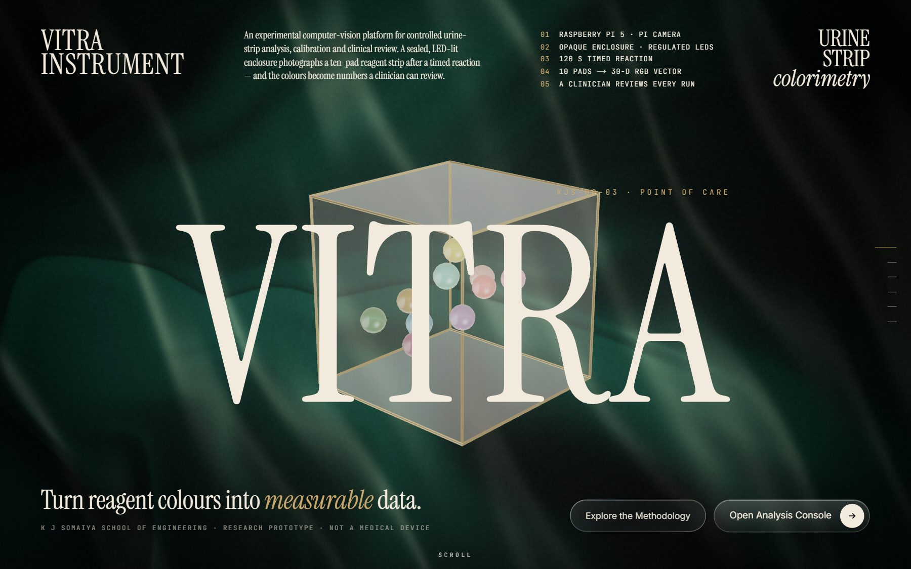

# VITRA

**Turn reagent colours into measurable data.**

A computer-vision research platform for **KJS-HC-03 — Urine Test Strip Reader using Colorimetry as a Point-of-Care Technology**<br/>K J Somaiya School of Engineering

[](https://vitra-lab.vercel.app)
&nbsp;


[Live demo](https://vitra-lab.vercel.app) · [How it works](#how-it-works) · [Screenshots](#screenshots) · [Run locally](#run-locally) · [Architecture](docs/architecture.md)

</div>

> **Research prototype. Not a medical device. Not clinically validated.** All bundled data, images and models are **SYNTHETIC**. Nothing here is a real patient sample, real reagent chemistry or a validated measurement. Collaborating organisations named in the use-case document do not endorse this software.

## Why

Urine dipsticks screen for diabetes, urinary tract infections, kidney and liver disorders — but they are read **by eye** against a printed chart: subjective, lighting-dependent and categorical. VITRA is the software for a sealed, LED-lit **Raspberry Pi 5** reader: it checks the photo, finds the ten pads, measures their colour, turns colour into numbers **only when a compatible calibration exists**, and routes every result to a clinician.

| **10** | **120 s** | **30-D** | **1** |
|:-:|:-:|:-:|:-:|
| reagent pads | timed reaction | RGB feature vector | clinician signs off every run |

## How it works

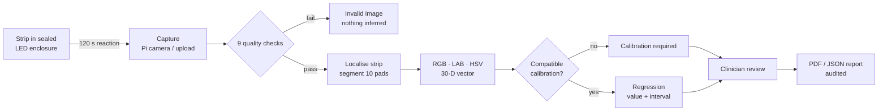

## Screenshots

| | |
|:-:|:-:|
| 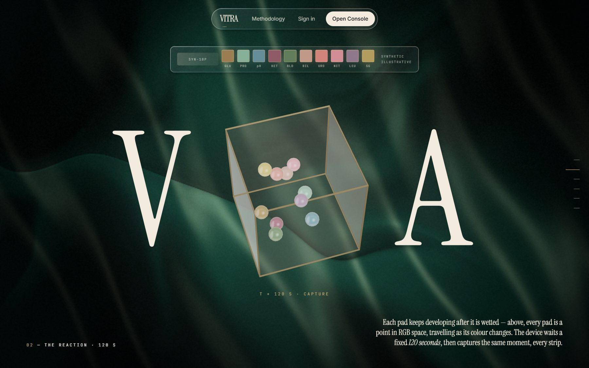 | 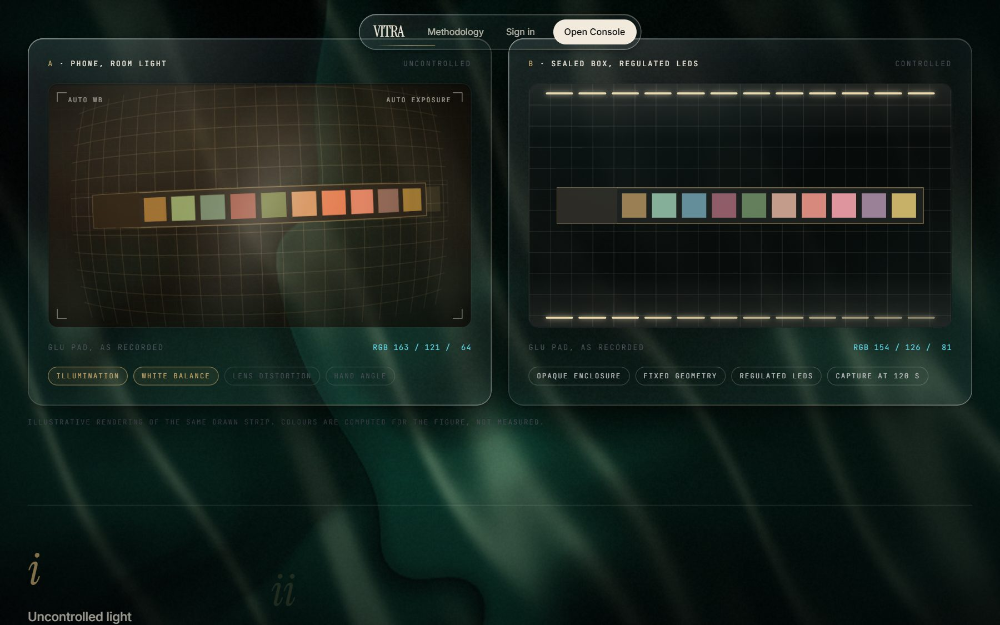 |
| The reaction — pads develop over 120 s | Why a phone can't: room light vs. the sealed box |
| 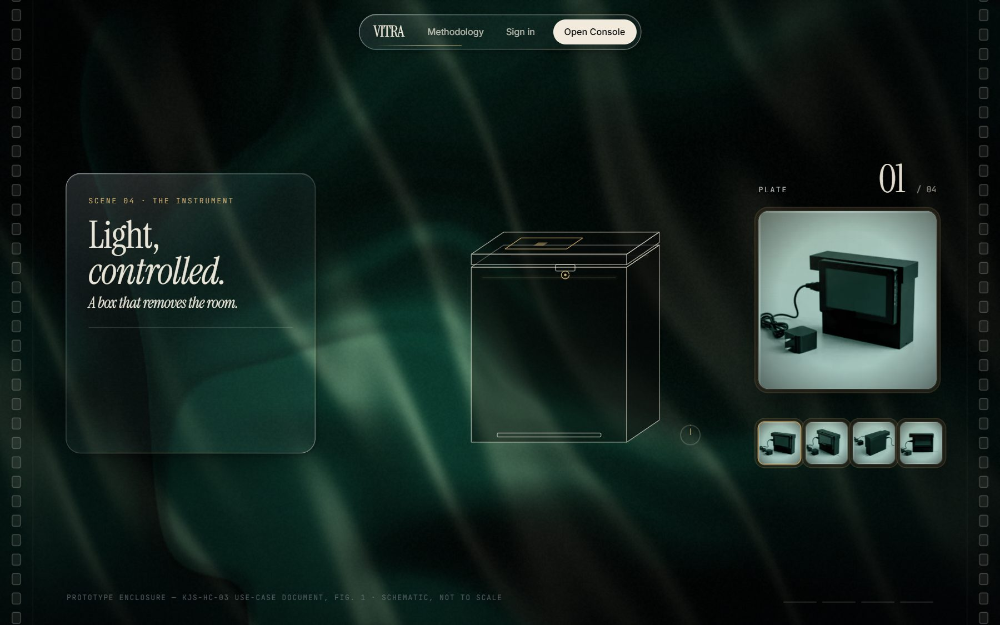 | 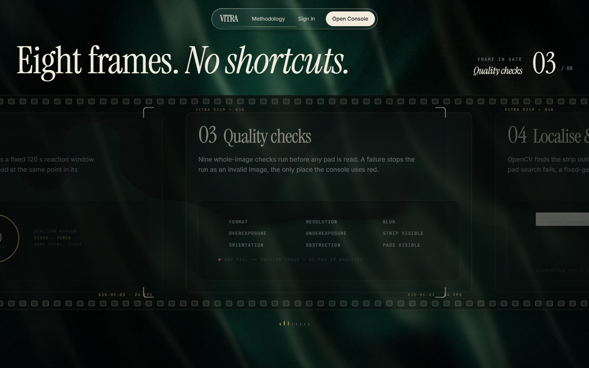 |
| The instrument — a box that removes the room | The pipeline, frame by frame |
| 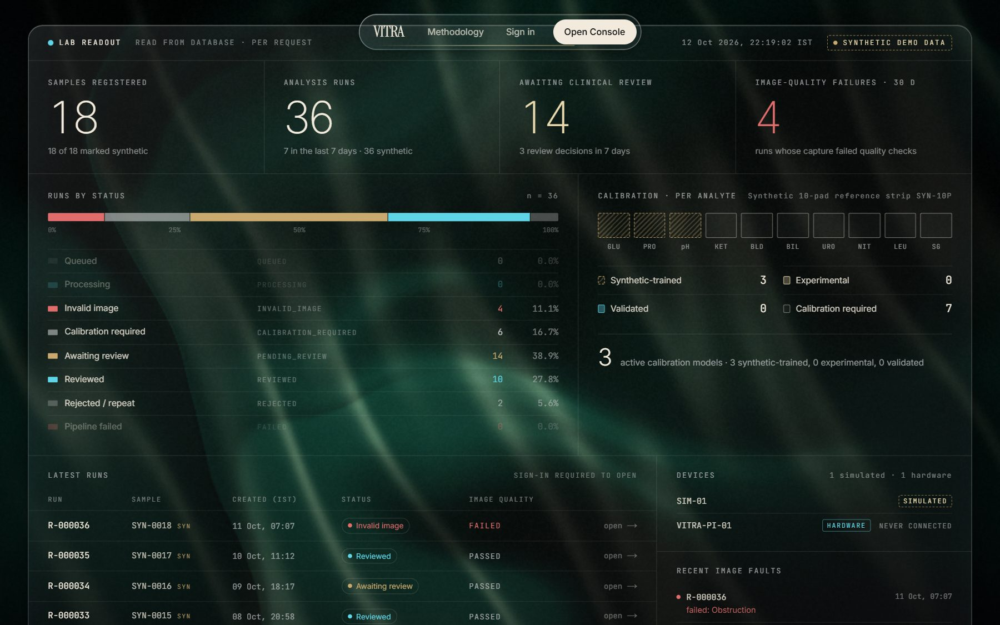 | 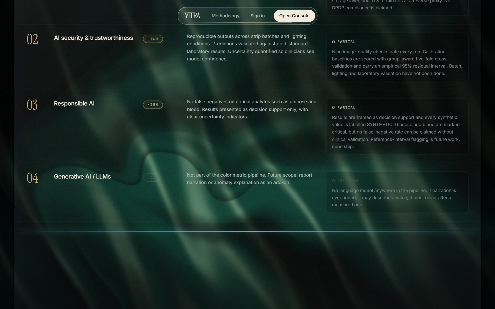 |
| Live lab readout, counted from the database | Governance: the use case vs. what the code does |
| 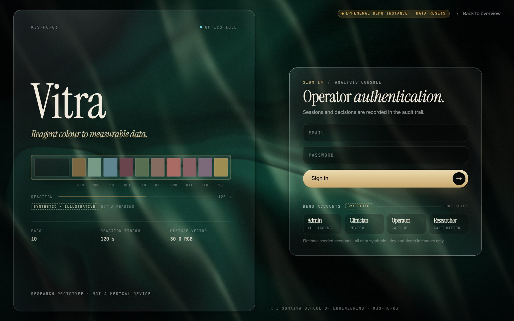 | 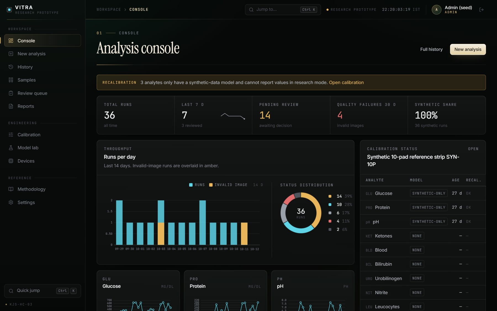 |
| Sign-in with one-click demo accounts | Analysis console |
| 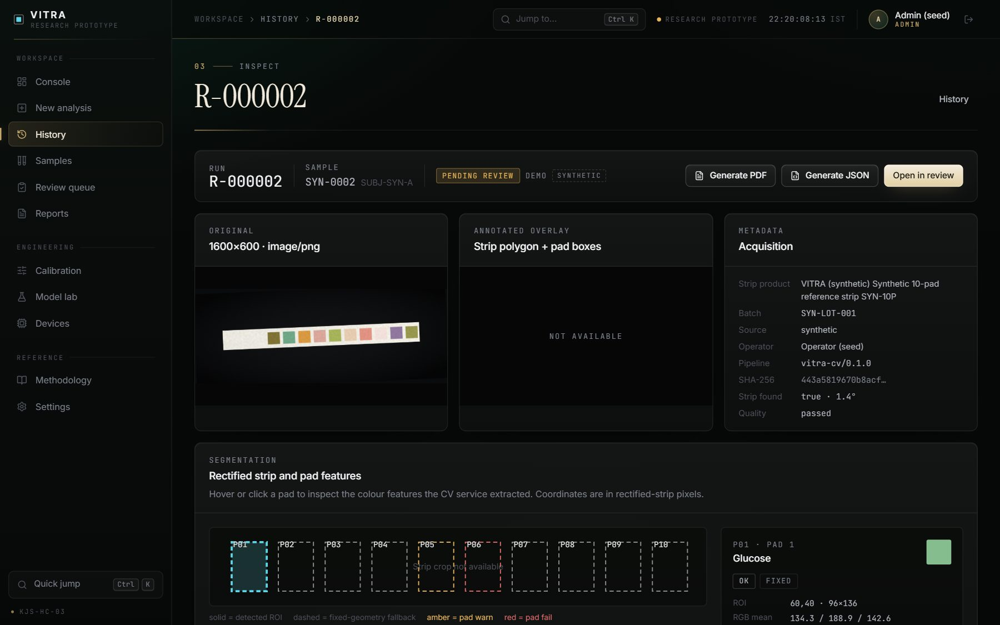 | 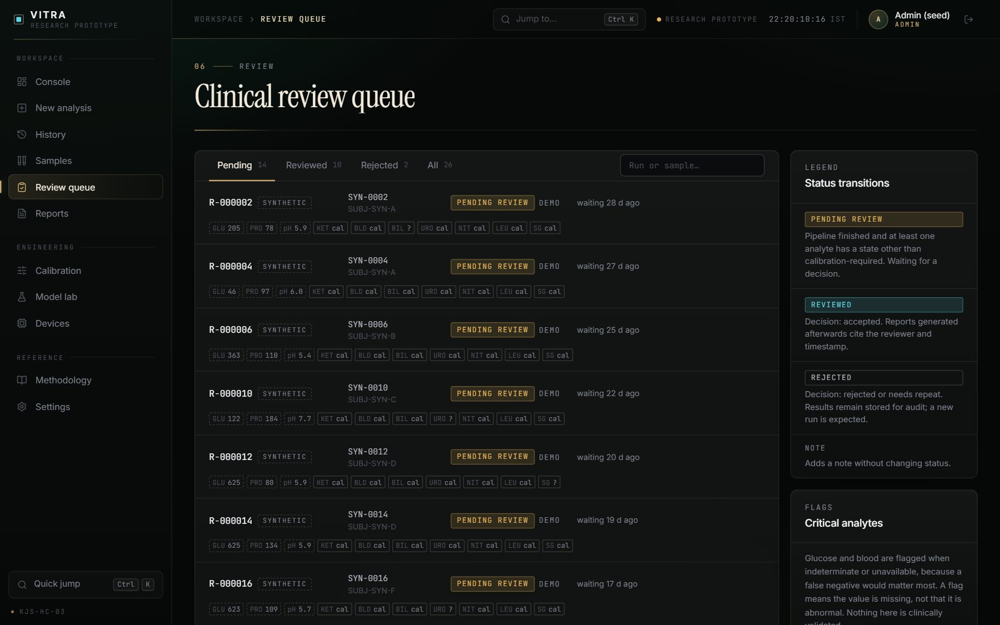 |
| Result inspector — quality, pads, states | Clinical review queue |

**Try it:** open the [live demo](https://vitra-lab.vercel.app), click **Open Analysis Console**, and use a one-click demo account (Admin · Clinician · Operator · Researcher). The hosted demo database is temporary and resets on its own.

## Layout

```
apps/web/      Next.js 15 (App Router, React 19, TS strict, Tailwind v4, Drizzle, zod, pdf-lib)
  app/           landing, methodology, login, (app)/… screens, api/… route handlers, actions/… server actions
  lib/           db, auth (scrypt + cookie sessions + RBAC), data/* (all queries), analysis, cv client,
                 inference policy, reports (PDF/JSON), storage, runtime-mode
  db/            schema.ts (Drizzle), migrations/*.sql, migrate.ts, seed.ts, fixtures/strips/*.png
  scripts/       bootstrap-models.ts
  tests/         unit (vitest), e2e (Playwright)
services/cv/   Python CV + calibration service (Starlette, OpenCV, scikit-learn)
docs/          architecture, CV service contract, device API, database, security
```

See [docs/architecture.md](docs/architecture.md) for how the pieces fit together.

## Run locally

```bash
# 1. CV service (Python 3)
cd services/cv
python -m venv .venv && source .venv/bin/activate      # Windows: .venv\Scripts\activate
pip install -r requirements.txt                        # tests: pip install -r requirements-dev.txt
python run.py                                          # http://127.0.0.1:8001/health
python -m unittest discover -s tests

# 2. Web app (Node 20.9+)
cd apps/web
npm install
cp .env.example .env.local                             # fill SESSION_SECRET etc.
npm run db:migrate && npm run db:seed                  # embedded PGlite in .data/pglite unless DATABASE_URL is set
npm run models:bootstrap                               # optional: trains the seeded synthetic models in the CV service
npm run dev                                            # http://localhost:3000
```

`db:migrate`, `db:seed` and `models:bootstrap` read `.env` / `.env.local` the same way `next dev` does. Other scripts:

| Script | What it does |
| --- | --- |
| `npm run db:reset` | Deletes the PGlite directory (or drops all VITRA tables on Postgres), re-migrates, re-seeds. |
| `npm run models:bootstrap` | Trains `glucose-poly2-v1`, `protein-poly2-v1` and `ph-poly2-v1` inside the CV service from the seeded synthetic CSV, and replaces the seeded fixture metrics with the service's own. When the CV service is unreachable it logs `SKIPPED` and exits 0. |
| `npm run typecheck` / `lint` / `test` | `tsc --noEmit`, ESLint, vitest. |
| `npm run test:e2e` | Playwright suite (see [apps/web/tests/README.md](apps/web/tests/README.md)). |

PGlite is single-process. Stop `npm run dev` before you run `db:seed`, `db:reset` or `models:bootstrap` against the same `.data/pglite`, or point them at another `PGLITE_DIR`.

### Demo logins (seeded, development only)

| Email | Password | Role |
| --- | --- | --- |
| `admin@vitra.local` | `vitra-admin` | admin: everything, including model validation |
| `clinician@vitra.local` | `vitra-clinician` | clinician: review and reports |
| `operator@vitra.local` | `vitra-operator` | operator: create runs |
| `researcher@vitra.local` | `vitra-researcher` | researcher: calibration, datasets, models, pad maps |

Override the passwords with `SEED_*_PASSWORD` before seeding any shared database.

## Database: PostgreSQL

VITRA runs on **PostgreSQL 15+**. When `DATABASE_URL` is set, the app uses node-postgres against that server. This is the primary path, and the one to use for any real or shared deployment. Without `DATABASE_URL`, local development uses embedded [PGlite](https://pglite.dev), which is PostgreSQL compiled to WASM, so the SQL and migrations are the same.

TLS for hosted databases:
- Add `?sslmode=require` to the URL, or set `PGSSLMODE=require`, or set `DATABASE_SSL=true`. `DATABASE_SSL` wins, and `false` disables TLS.
- Certificates are verified by default. Set `DATABASE_SSL_REJECT_UNAUTHORIZED=false` only for a provider with a private CA.

### Deploy with hosted PostgreSQL (Neon / Vercel Postgres)

1. Create a database (Neon, or Vercel → Storage → Postgres) and copy its connection string, including `?sslmode=require`.
2. In the Vercel project (Root Directory `apps/web`), set `DATABASE_URL` to that string. Also set `SESSION_SECRET`, `CV_SERVICE_TOKEN`, `DEVICE_INGEST_SECRET`, the `SEED_*_PASSWORD` values and `CV_SERVICE_URL`.
3. Run this once from your machine against that database:
   ```bash
   cd apps/web
   DATABASE_URL='postgres://…?sslmode=require' npm run db:migrate
   DATABASE_URL='postgres://…?sslmode=require' npm run db:seed
   ```
4. Redeploy. The ephemeral-demo notice disappears once `DATABASE_URL` is set.

Files are a separate concern from the database. Vercel's deployment filesystem is read-only, so on Vercel `STORAGE_DIR` defaults to `/tmp/vitra-storage`. That location is writable but **not durable**: uploads, overlays and generated reports are lost when the instance recycles. Durable object storage is not implemented yet. Two consequences of seeding from your own machine:
- The six seeded fixture images are served from the copies bundled in `db/fixtures/strips`, so they still display.
- The seeded calibration CSV stays on your machine. Re-import a dataset in Calibration Studio before you train on Vercel.

### Vercel without a database (temporary demo fallback)

If `DATABASE_URL` is not set on Vercel (`VERCEL` env present), the app does not fail. It falls back to a **temporary demo**:
- PGlite runs in `/tmp/vitra-pglite`, with files in `/tmp/vitra-storage`.
- The first request in each cold serverless instance applies the migrations and the synthetic seed. This takes a few seconds, so the first page load is slow.
- The app shell and login page show an amber "Ephemeral demo instance · data resets" notice.

Limits of the fallback:
- Each instance has its own database.
- Anything created there (runs, reviews, reports, sessions) disappears when the instance is recycled or a request lands on a different instance. You may be signed out unexpectedly.
- It exists only so the screens can be browsed. Use hosted PostgreSQL for anything else.

`next.config.ts` (`outputFileTracingIncludes`) adds the following to the serverless bundle:
- PGlite's WASM and data files
- `db/migrations/*.sql`
- the fixture PNGs

### CV service

The Python service cannot run on Vercel. Host it elsewhere (any container host) and set `CV_SERVICE_URL` and `CV_SERVICE_TOKEN`. Until then, `/api/health` reports `degraded`, new analyses are stored as `failed` with every analyte `unavailable`, and seeded runs still display.

## Features

- **Analysis:** upload or browser-camera capture, with a reaction timer and strip product/batch selection.
  1. 9 whole-image quality checks.
  2. Strip localisation and rectification, then pad segmentation.
  3. RGB, CIELAB and HSV features per pad.
  4. Per-analyte inference under an explicit result-state policy: measured, experimental, synthetic, out_of_range, indeterminate, invalid_image, unavailable or calibration_required.
  5. A result inspector with the original image, overlay, pad inspector and subject trend.
- **Review:** a clinician queue with accept, reject, needs-repeat and note decisions, audited.
- **Reports:** PDF and JSON reports (pdf-lib) with SHA-256, linked to the run and pseudonymous sample.
- **Calibration studio:**
  - CSV dataset import with validation.
  - Training of linear, poly2/poly3 ridge, kNN and random-forest models in the CV service, with a group-aware split, 5-fold CV and empirical 95 % intervals.
  - A model lifecycle: draft, trained, validated (admin plus written evidence; the DB forbids validating synthetic-trained models), retired.
  - Pad-map editor.
- **Model lab:** model table, per-model evaluation detail (train / test / 5-fold CV metrics, predictions vs reference), side-by-side comparison, status controls.
- **Devices:** device registry, rotating API keys, and an ingest API (`POST /api/ingest`, `X-Device-Id` = device name, `Idempotency-Key`; see [docs/device-api.md](docs/device-api.md)). A clearly labelled simulated device is included.
- **Security:**
  - scrypt passwords and HttpOnly cookie sessions.
  - RBAC across 5 roles.
  - zod-validated server actions and protected file serving.
  - An audit trail for every state change.
  - Middleware forwards the requested path so sign-in returns you to it (`/login?next=…`).
- **Honesty rules:**
  - Synthetic data is labelled SYNTHETIC everywhere.
  - No green "normal" / red "abnormal" indicators; red is reserved for image and system faults.
  - No fabricated concentrations, accuracy figures or telemetry.

## What was verified (12 Oct 2026, Windows 11, Node 24, Python 3.14)

- `npx tsc --noEmit`: 0 errors.
- `npx vitest run`: 5 files, **42/42 tests passed**.
- `python -m unittest discover -s tests` (services/cv, with `requirements-dev.txt`): **24/24 passed**.
- `npm run db:migrate && npm run db:seed`:
  - Succeeds on PGlite.
  - Succeeds over the PostgreSQL wire protocol through node-postgres. The server in that test was a `pglite-socket` server, not a managed Postgres.
  - Re-running the seed is idempotent, and `db:reset` works on both.
- `npm run models:bootstrap` against a running CV service trained all 3 seeded synthetic models. Test MAE on synthetic held-out rows was 13.8 mg/dL (glucose), 8.9 mg/dL (protein) and 0.08 pH. These are fit-to-synthetic numbers only, not accuracy.
- Simulated Vercel cold start (`VERCEL=1`, scratch `PGLITE_DIR`): the first `getDb()` migrated and seeded automatically. Concurrent first calls shared one bootstrap, and a warm restart skipped the seed.
- Playwright `tests/e2e/smoke.spec.ts` against `next dev`: **4/4 passed**, covering `/`, `/methodology`, `/login` and, as admin, `/console`, `/analysis/new`, a seeded run, `/history`, `/samples`, `/review`, `/reports`, `/calibration`, `/model-lab`, `/devices` and `/settings`.

- `next build` passes, and the app is deployed on Vercel at https://vitra-lab.vercel.app in the ephemeral demo mode: a cold start migrates and seeds automatically, and the live lab readout and demo sign-in work.

Not verified here:
- A managed PostgreSQL provider (Neon / Vercel Postgres) with TLS.
- The CV pipeline on real (non-synthetic) strip photographs.

## Known limitations

- The CV pipeline and every model are tuned and trained on **synthetic** strips only. Nothing is clinically validated, and the Paramcare strip record is a placeholder whose pad order must be confirmed against the product insert.
- Seeded runs show one of six synthetic fixture renders as their "original" image. Their quality checks, pad features and values were generated by the seed, not extracted from that image, and every seeded run says so in its warnings. Seeded runs have no overlay or strip crop.
- Seeded calibration models are DB fixtures until `npm run models:bootstrap` (or Calibration Studio) trains them in the CV service. Until then, live demo inference reports `unavailable`.
- Analysis is synchronous; there is no job queue.
- PGlite is single-process. The Vercel fallback is per-instance and ephemeral (see above).
- The site is designed for desktop (≥ 1280 px).
